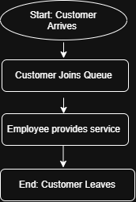
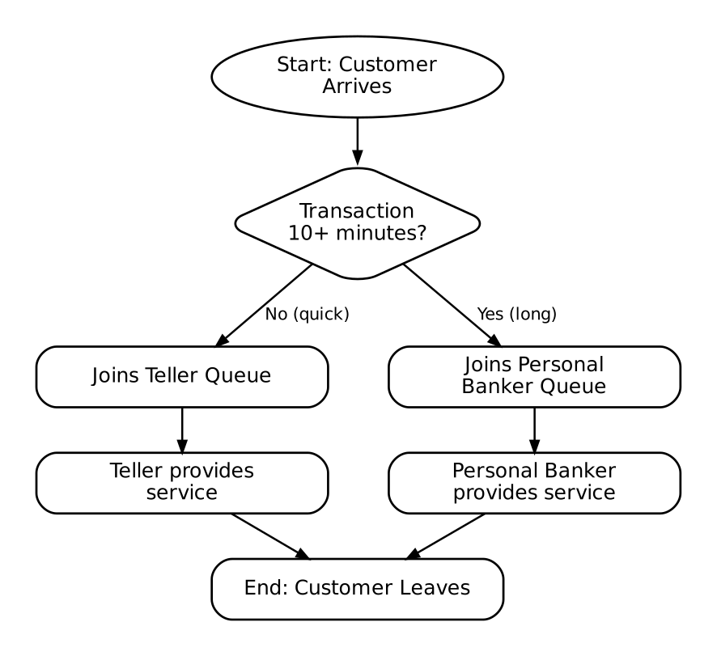
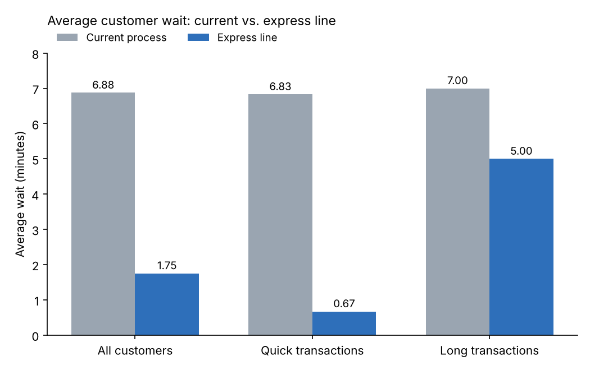

# Customer Wait-Time Improvement Project

**I simulated a customer line at a small branch and found that an express line could cut the average wait by about 75% (6.9 → 1.75 minutes) without hiring anyone.**

*Independent Systems Engineering project*

> **Note:** All data in this project is simulated for learning purposes. I did not use any real customer or bank data.

---

## Why I Did This Project

I work as a bank teller, and I noticed that during busy times one long transaction can hold up the whole line. A customer who only needs a quick deposit ends up waiting behind someone with a 15-minute request. I wanted to see if changing the process, instead of adding more staff, could fix this.

## Goal

Find out why customers wait and come up with a process change that reduces wait times **without adding employees**.

## Who This Affects

| Who | What they need |
|---|---|
| Customers | Short, predictable waits |
| Tellers | A steady, manageable line |
| Branch manager | Better service without extra labor cost |

**My requirements for a good solution:**
1. Lower the average wait time.
2. Don't add any employees.
3. Don't make customers with long transactions wait too long.

## The Current Process

Right now, one teller serves every customer in the order they arrive.

**Why customers were waiting:**
1. **Busy periods:** several customers show up at almost the same time (9:30–9:33).
2. **Long transactions block the line:** when one customer takes 12–15 minutes, everyone behind them waits.

## My Proposed Fix: An Express Line

Transactions that take **10 minutes or more** go to the personal banker, who is already on staff. Quick transactions stay with the teller, so they don't get stuck behind long ones.

## How I Tested It

I built the simulation in a spreadsheet. To make it a fair comparison, I used the **same 8 customers with the same transaction times** in both scenarios. The only thing that changes is the process.

| Item | What I used |
|---|---|
| Customers | 8, arriving between 9:00 and 9:33 (busiest from 9:30 to 9:33) |
| Transaction times | 3–4 minutes (quick) and 12–15 minutes (long) |
| "Long" transaction | 10 minutes or more |
| Current process | 1 teller serves everyone |
| Express line | Teller handles quick, personal banker handles long |
| How I measured wait | Time service started − time customer arrived |
| Tools | Google Sheets / Excel, diagrams.net |

You can see every calculation in [`customer_wait_time_data.xlsx`](customer_wait_time_data.xlsx) and the raw data in [`customer_wait_time_data.csv`](customer_wait_time_data.csv).

## Results

| | Current process | Express line |
|---|---:|---:|
| Average wait (everyone) | 6.88 min | **1.75 min** |
| Average wait (quick transactions) | 6.83 min | **0.67 min** |
| Average wait (long transactions) | 7.00 min | 5.00 min |
| Longest wait | 28 min | **10 min** |
| Employees | Same staff | Same staff |

The express line cut the average wait by about **75%** without adding anyone.

## Trade-offs I Found

- **Long transactions still wait sometimes.** One customer with a 15-minute transaction waited 10 minutes because the personal banker was already busy. Long-transaction customers still did better overall (7 → 5 minutes), but this is where most of the remaining wait is.
- **The personal banker has less time for their other work.**
- **Someone has to sort customers correctly.** If people are sent to the wrong line, the benefit goes down.

## What I Learned

- The problem wasn't too few people. It was how customers moved through the line. Changing the process made a big difference without spending more on staff.
- Averages can hide problems, so I also looked at quick and long customers separately and at the single longest wait.
- Using the same customers in both scenarios was important. Otherwise I couldn't tell whether the improvement came from the process or from different data.

## Limitations and Next Steps

- This is a small, simulated sample (8 customers). Before using this in real life, I would test it with real, anonymized timing data.
- Next, I'd like to test different numbers of customers and different busy periods.
- I'd also try other cutoffs for a "long" transaction, like 8 or 12 minutes. You can change this in the spreadsheet's Assumptions tab.
- Other ideas to compare: appointments for long transactions, or one shared line for both staff.

## Files

| File | What it is |
|---|---|
| `customer_wait_time_data.xlsx` | Both scenarios with formulas and a summary |
| `customer_wait_time_data.csv` | Raw simulated data |
| `current_process.png` | Current process flowchart |
| `express_line_process.png` | Express-line flowchart |
| `wait_time_comparison.png` | Results chart |

## Skills Used

Process mapping · Finding bottlenecks · Simulation · Requirements · Trade-off analysis · Spreadsheets · Data visualization · Documentation
